<a href="https://dueproof-app.vercel.app"></a>

<p align="center">
  <a href="https://dueproof-app.vercel.app"></a>
  <a href="https://dueproof.vercel.app"></a>
  <a href="docs/index.md"></a>
  <a href="LICENSE"></a>
  <a href="CHANGELOG.md"></a>
</p>

<p align="center">
  Dueproof reads tax, regulatory and court notices (India first), finds what's owed and by when,<br>
  and proves every finding on the page it came from. A person decides; code computes every date.
</p>

<h2></h2>


A notice arrives by email, through a tax portal, or as a phone photo of a
posted letter. Somewhere in it is a sentence that says what you must do, and a
date, often *"within 30 days of receipt"*, counted from a day nobody wrote
down. Dueproof reads the notice, opens a case for it, and puts each duty in
the deadline register, with the sentence outlined on the page.

<h2></h2>

<p align="center">
  
  
</p>
<p align="center">
  
  
</p>
<p align="center">
  
  
  
</p>

Beyond the reading: cases with stages, threads and approval; a review queue;
clients with their registrations and statutory calendar; demand, interest and
penalty estimates; and reports, including an evidence report with page crops.

<h2></h2>

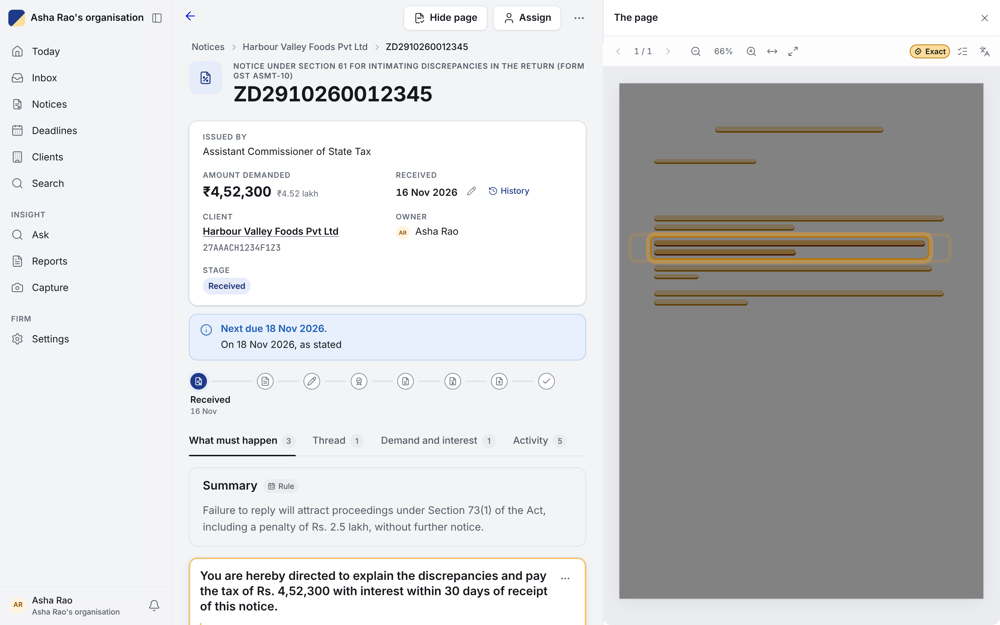

<p align="center">
  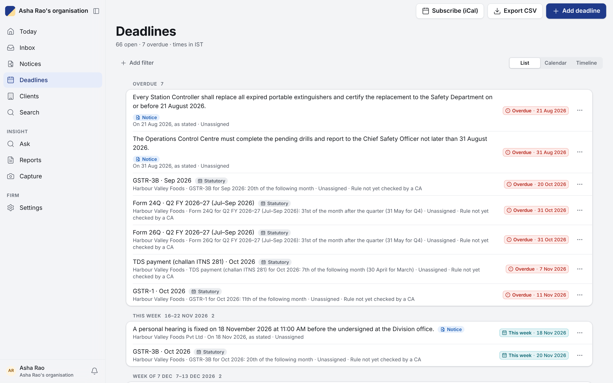
  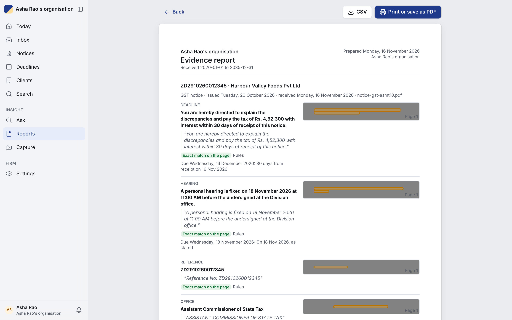
</p>

<h2></h2>


| Edition | What you get |
|---|---|
| **Hosted** | Run by us on Vercel, Neon and Cloudflare R2: <https://dueproof-app.vercel.app>. App and database in Singapore, files in Asia-Pacific, not yet in India ([Deployment](docs/deployment.md)). |
| **Self-hosted Free** | Everything that reads, proves and tracks notices, on your own server with Docker Compose. No telemetry, no phone-home. |
| **Self-hosted Business** | Free plus SAML single sign-on, signed audit export and white-label reports, unlocked by an offline licence key ([`ee/`](ee/)). |
| **Desktop** | A Tauri 2 app that connects to your server, with OS notifications and a tray. Linux today; Windows and macOS are coming ([Desktop app](docs/desktop.md)). |
| **Phone** | The web app installs as a PWA, with camera capture and Web Push. |

<h2></h2>

### Hosted

Open <https://dueproof-app.vercel.app> to try it. Nothing to install.

### Self-hosted with Docker

On a Linux server with Docker Engine 24+ and the Compose plugin (4 vCPU,
8 GB RAM, 40 GB disk):

```bash
git clone https://github.com/MaanavKrishna/dueproof && cd dueproof/infra/docker
cp .env.example .env
# four secrets, 32+ characters each
for k in AUTH_SECRET ENGINE_SHARED_SECRET POSTGRES_PASSWORD CRON_SECRET; do
  sed -i "s|^$k=.*|$k=$(openssl rand -hex 32)|" .env
done
# set DUEPROOF_DOMAIN in .env to your domain, or localhost for a trial
docker compose up -d --build
```

Open `https://<your domain>` and sign up: the first account owns the
organisation, and after that sign-up is by invitation. Keep a copy of `.env`
somewhere safe, away from the server. The full guide, with email, offline
translation, backups and upgrades, is [Install](docs/install.md).

### Development

You need Node 22+, pnpm 10 and, for the engine, Python with
[uv](https://docs.astral.sh/uv/).

```bash
pnpm install
cp apps/app/.env.example apps/app/.env.local   # set AUTH_SECRET (openssl rand -hex 32)
pnpm dev
```

The app runs at <http://localhost:3000> on embedded Postgres (PGlite) with a
fake engine that answers from the real engine's recordings, so no other
service is needed. To read real documents, run the engine
(`services/engine`) and set `ENGINE_MODE=http`.

```bash
pnpm lint && pnpm typecheck && pnpm test     # every package
pnpm --filter @dueproof/app e2e              # Playwright, on a production build
cd services/engine && uv run python -m unittest discover -s tests -t . -v
```

Read the house rules in [CONTRIBUTING.md](CONTRIBUTING.md) before changing
anything (frozen contracts, computed dates, the proof gate, org-scoped queries).

<h2></h2>


```
apps/app            the product (Next.js)
apps/site           website and docs (Next.js)
apps/desktop        desktop shell (Tauri 2)
services/engine     Python engine: read, OCR, translate, rules, proof
packages/*          contracts, db, core (date engine, policy), ui, tokens,
                    icons, ai, auth, storage, engine-client, i18n, plugins
ee/                 Business features, under a commercial licence
infra/              Docker Compose, Vercel and Sandbox setups
docs/               documentation (also rendered on the website)
```

More in [Architecture](docs/architecture.md).

<h2></h2>

| Start | Use | Run | Reference |
|---|---|---|---|
| [Overview](docs/index.md) | [Notices](docs/notices.md) | [Deployment](docs/deployment.md) | [API](docs/api.md) |
| [Install](docs/install.md) | [Workflow and reminders](docs/workflow-and-reminders.md) | [Desktop app](docs/desktop.md) | [Architecture](docs/architecture.md) |
| [Quickstart](docs/quickstart.md) | [Languages](docs/languages.md) | [Backup and restore](docs/backup-and-restore.md) | [Evaluation](docs/evaluation.md) |
| | [Notice types](docs/profiles.md) | [Upgrading](docs/upgrading.md) | [FAQ](docs/faq.md) |
| | | [Accounts and SSO](docs/accounts-and-sso.md) · [Configuration](docs/configuration.md) · [Security](docs/security.md) | |

<h2></h2>

v0.1.0 is in beta. See the [changelog](CHANGELOG.md) and the
[roadmap](ROADMAP.md). Before you rely on Dueproof for real deadlines, run it
beside your current process.

- **Statutory periods and interest rates are data with a source.** Each is
  marked "verify" until a chartered accountant signs it off. Interest and
  penalty figures are estimates, not advice.
- **Languages.** Notices in all 22 scheduled languages are read, stored and
  searchable. Offline translation has been tested end to end in Hindi, Tamil,
  Bengali, Urdu, Telugu and Malayalam; the other 16 use the same path. Scans
  in Indian scripts need the matching Tesseract pack ([Languages](docs/languages.md)).
- **Hosted email** (invitations, password resets, the digest) needs a mail
  provider; until then, copy invite links from Team and access.
- **Hosted pages below the OCR confidence bar** aren't yet sent to the heavy
  engine.
- **Notice languages** are set per organisation, not per client.
- **Desktop** builds are made for Linux; Windows and macOS are coming.
- **Hosted data** is stored in Singapore (database) and Asia-Pacific (files),
  not in India.

<h2></h2>

The most useful contributions are a notice Dueproof gets wrong, reduced to a
few invented sentences (never a real document), depth for a language you read,
and a notice type for your kind of organisation. Start with
[CONTRIBUTING.md](CONTRIBUTING.md).

**Found a security problem?** Please report it privately, through the
repository's **Security** tab. See [SECURITY.md](SECURITY.md).

<h2></h2>

[PolyForm Shield 1.0.0](LICENSE). Free to use, self-host, modify and improve.
You may not sell it or offer it as a competing product or service.
Third-party components are listed in [NOTICE](NOTICE).

The exception is the [`ee/`](ee/) directory: the Business features (SAML
single sign-on, audit export, white-label reports and the offline licence
check) are under a [commercial licence](ee/LICENSE) and work only with a valid
Dueproof Business licence. Nothing outside `ee/` depends on it: delete the
directory and you have Self-hosted Free, which builds and runs on its own.

<br>

<a href="https://dueproof-app.vercel.app"></a>
