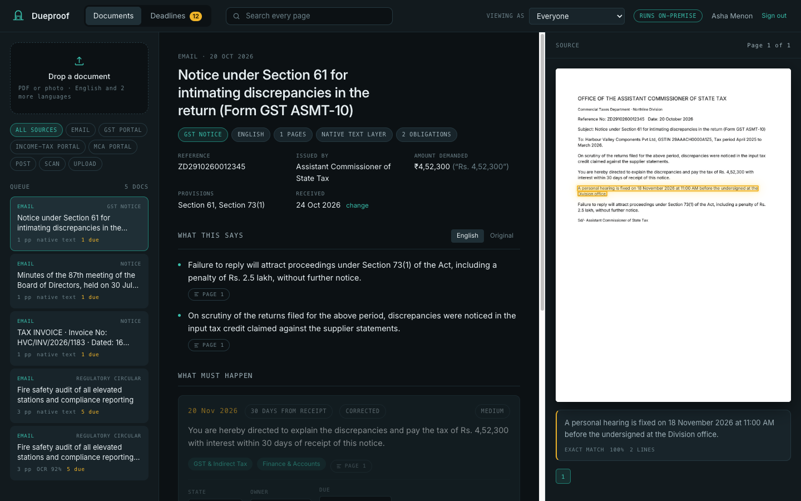
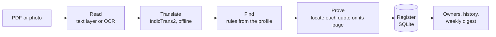
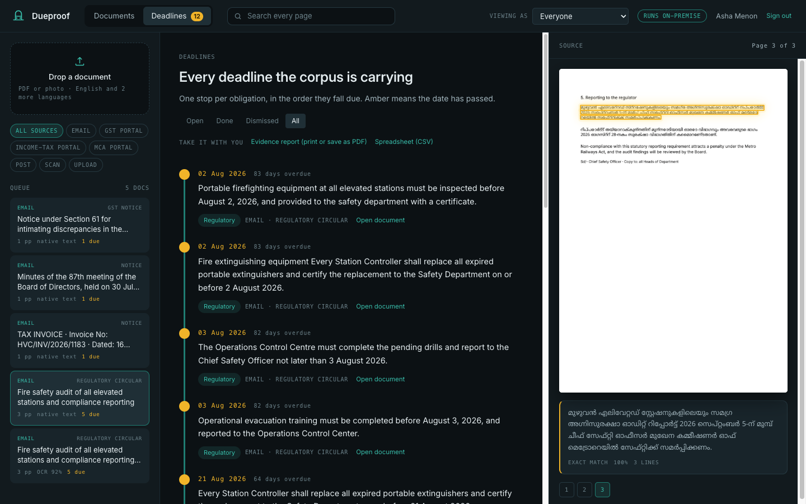
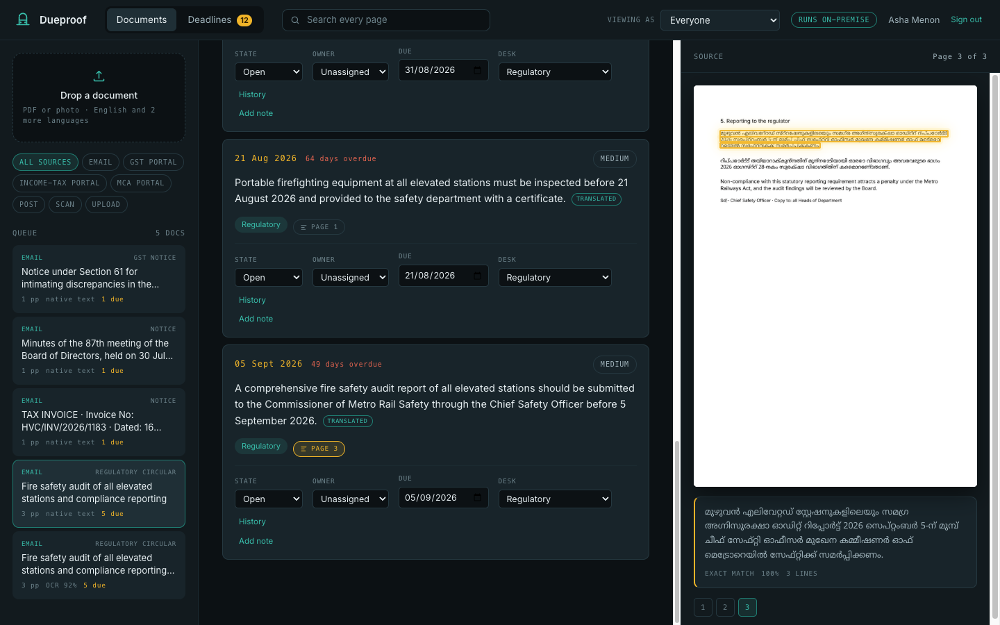

<div align="center">


# Dueproof

**Every due date in your notices, with proof from the page.**

Dueproof reads tax, regulatory and court notices in English and 22 Indian
languages, typed or photographed, and keeps one register of what is owed and
by when. Every entry is outlined on the page it came from.
It runs on your own server: no cloud, no API keys, no language model.

[](https://github.com/MaanavKrishna/dueproof/actions/workflows/ci.yml)
[](LICENSE)
[](pyproject.toml)
[](docs/languages.md)

[Website](https://maanavkrishna.github.io/dueproof/) ·
[Install](docs/install.md) ·
[Quickstart](docs/quickstart.md) ·
[Documentation](docs/index.md) ·
[Roadmap](ROADMAP.md)

</div>



## Why it exists

A notice arrives by email, through a tax portal, or as a phone photo of a
posted letter. Somewhere in it is a sentence that says what you must do, and a
date, often *"within 30 days of receipt"*, counted from a day nobody wrote
down. Someone copies it into a spreadsheet. Months later an auditor asks how
you knew, and the answer is a cell with no source.

Dueproof keeps that register for you, and every row points back to the line on
the page that set it.

## Who it is for

- **CA and CS firms** juggling GST, income-tax, TDS and MCA notices across
  hundreds of clients.
- **Company secretaries** handling ROC letters, stock-exchange queries, and SEBI
  and RBI circulars.
- **Compliance teams at lenders and NBFCs** with circulars in English and
  orders and summons in regional languages, and no permission to send any of it
  to a cloud service.

The default profile knows Indian tax, corporate, labour, regulatory and court
notices. Starter profiles cover hospitals, municipalities and metro rail, and a
profile for your own work is a file of word lists.

## What it does

| | |
|---|---|
| **Finds what you owe, and by when** | Duties, deadlines, hearings, amounts demanded, reference numbers, the issuing office and the sections cited |
| **Counts from your receipt** | "Within 30 days of receipt" is counted from the day the notice reached you, which you can correct |
| **Shows its work** | Each finding is outlined on its page and graded *exact*, *strong* or *approximate*. If a passage can't be located, it says so instead of guessing |
| **Reads Indian languages** | All 22 scheduled languages, translated into English on your machine by IndicTrans2. The original wording stays the proof |
| **Reads phone photos** | Skewed scans and forwarded JPEGs go through OCR, and the outlines still land on the right words |
| **Runs the work** | Owners, statuses, corrected dates and desks, notes, full history, and a weekly email of what is due |
| **Hands you the evidence** | Full-text search in every script, a printable evidence report with each passage cropped from its page, and CSV |
| **Stays in the building** | Sign-in or your own SSO, an append-only audit trail, backups with verify and restore |

## How it works



No language model decides anything. Rules find the findings, so for any entry
someone can say which words caused it. The translation model only helps the
rules read other languages.

## Try it in five minutes

You need Python 3.12+ and [Tesseract](https://tesseract-ocr.github.io/)
(`brew install tesseract tesseract-lang`, or
`apt install tesseract-ocr tesseract-ocr-hin`).

```bash
git clone https://github.com/MaanavKrishna/dueproof && cd dueproof
```

```bash
python3 -m venv .venv && .venv/bin/pip install -e .
```

```bash
.venv/bin/dueproof users add you@example.org --admin
```

```bash
.venv/bin/dueproof serve
```

Open <http://127.0.0.1:8000>, sign in, and drop in a PDF or a photo of a
notice. `dueproof doctor` checks the setup and tells you what is missing.
Docker and systemd setups are in [Deployment](docs/deployment.md).

<table>
<tr>
<td></td>
<td></td>
</tr>
<tr>
<td align="center"><sub>Every deadline, in the order it falls due</sub></td>
<td align="center"><sub>A Malayalam passage, translated, and outlined in the original</sub></td>
</tr>
</table>

## Languages

English, plus Assamese, Bengali, Bodo, Dogri, Gujarati, Hindi, Kannada,
Kashmiri, Konkani, Maithili, Malayalam, Manipuri, Marathi, Nepali, Odia,
Punjabi, Sanskrit, Santali, Sindhi, Tamil, Telugu and Urdu.

- **Scans and photos** are read in 15 of them. The other 7 are read from typed
  PDFs, because no OCR model exists for them yet.
- **Tested end to end** with the translation model: Hindi, Tamil, Bengali,
  Urdu, Telugu and Malayalam. The others use the same path; reports welcome.
- Switch them on with `DUEPROOF_LANGUAGES=hi,ta,bn` or `all`. Details in
  [Languages](docs/languages.md).

## What it will never do

- **Send your documents anywhere.** Running on your own machine is the point.
- **Act on its own.** It never files a reply or makes a payment. It proposes;
  a person decides.
- **Replace the rules with a model.** Being able to say why a sentence was
  flagged is the product.
- **Rewrite a translation to "fix" it.** A doubtful translation is flagged,
  and the original is shown.
- **Guess where a passage is.** No outline is better than a wrong one.

## Status

Version 0.1, early. It works end to end and is tested: 265 tests, plus an
accuracy gate in CI that fails if any finding is outlined confidently in the
wrong place. It has been measured only on a small, fictional set of notices.
Before you rely on it for real deadlines, run it beside your current process
and measure it on your own documents with `dueproof eval`.

What comes next, and in what order, is in the [roadmap](ROADMAP.md).

## Documentation

| Start | Use | Run | Reference |
|---|---|---|---|
| [Install](docs/install.md) | [Notices](docs/notices.md) | [Accounts and SSO](docs/accounts-and-sso.md) | [Evaluation](docs/evaluation.md) |
| [Quickstart](docs/quickstart.md) | [Workflow and reminders](docs/workflow-and-reminders.md) | [Deployment](docs/deployment.md) | [API](docs/api.md) |
| [Overview](docs/index.md) | [Languages](docs/languages.md) | [Configuration](docs/configuration.md) | [Architecture](docs/architecture.md) |
| | [Profiles](docs/profiles.md) | [Security](docs/security.md) | [FAQ](docs/faq.md) |

The same pages, easier to read, are on the [website](https://maanavkrishna.github.io/dueproof/docs/).

## Repository layout

```
dueproof/      the product: pipeline/, profiles/, web/ (API and browser app), tools/
tests/         unittest suite, sample notices, the golden file
docs/          documentation (also rendered on the website)
deploy/        systemd units and a Caddy example
scripts/       serve.sh and test.sh for development
website/       the project website (Next.js), not part of the product
```

## Contributing

The most useful contributions are a profile for your kind of organisation,
depth for a language you read, and a notice Dueproof gets wrong, reduced to a
few invented sentences, never a real document. Start with
[CONTRIBUTING.md](CONTRIBUTING.md).

Found a security problem? Please report it privately. See [SECURITY.md](SECURITY.md).

## Licence

[Apache 2.0](LICENSE). Everything one organisation needs to read its notices
and trust the result is open source, and stays that way. Third-party
components are listed in [NOTICE](NOTICE).
