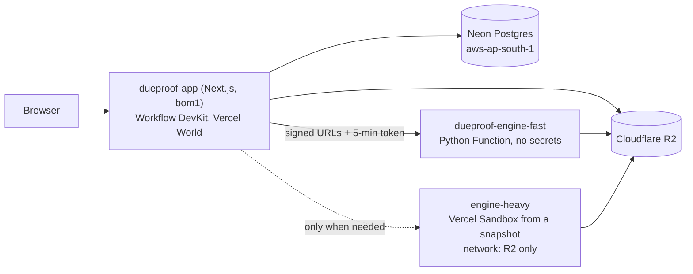

# Deployment

Dueproof v0.1 runs three ways:

| | Where | Guide |
|---|---|---|
| **Self-hosted server** | Your Linux server, Docker Compose: app + engine + Postgres + Caddy | [Install](install.md), [Backup and restore](backup-and-restore.md), [Upgrading](upgrading.md) |
| **Hosted** | Vercel (app, workflows, engine-fast, engine-heavy in Sandbox) + Neon + Cloudflare R2, Mumbai | [`infra/vercel/README.md`](../infra/vercel/README.md) |
| **Desktop** | Tauri app, Local or Connect mode | arrives with the desktop app |

The demo's systemd and single-container instructions (0.0.x) no longer apply.

## Hosted, in short

- **engine-fast** reads every document: PDF text layer, PaddleOCR, rules and
  proof. It is its own Vercel project holding no secret except its token key,
  because a function's outbound network can't be restricted.
- **engine-heavy** handles what engine-fast can't: pages below the OCR
  confidence bar (Tesseract) and offline translation (IndicTrans2). The
  workflow starts a Sandbox microVM from a prebuilt snapshot with a network
  policy that allows only the storage host, runs the batch and stops it
  (`apps/app/lib/heavy-engine.ts`). It is off until `HEAVY_ENGINE_SNAPSHOT_ID`
  is set.
- Files never pass through a function: browsers and the engine use signed
  storage URLs that expire within 5 minutes.

Configuration lives in `apps/app/vercel.ts` (region `bom1`, Fluid compute,
function durations) and `services/engine/vercel.json`. The full set of
environment variables for each project is in
[`infra/vercel/README.md`](../infra/vercel/README.md).

## Environment variables

The app validates its environment at start and names any variable that is
missing or wrong (never its value). The complete list with defaults is
`apps/app/.env.example`; the self-hosted subset is
`infra/docker/.env.example`.

## Health and metrics

| Endpoint | What | Who can reach it |
|---|---|---|
| `GET /api/health` | Database and engine reachability and timings, version, edition. 200 (`ok`/`degraded`) or 503 (`down`) | Self-hosted: only from the server (Caddy refuses it). Hosted: public, holds no secrets |
| `GET /api/metrics` | Prometheus text: parts up, check times, workflow runs by status, rate-limit refusals, memory | Loopback only, or anyone with `Authorization: Bearer $METRICS_TOKEN` |

## Security headers and limits

Every response carries a strict Content Security Policy (a fresh nonce per
page, `strict-dynamic`, `frame-ancestors 'none'`), HSTS (with preload on
hosted), `Referrer-Policy: same-origin`, a restrictive `Permissions-Policy`
and `X-Content-Type-Options: nosniff`. Sign-in, sign-up and uploads are
rate-limited per IP, user and organisation, with counters in Postgres so
limits hold across instances; change them with `RATE_LIMITS`.
