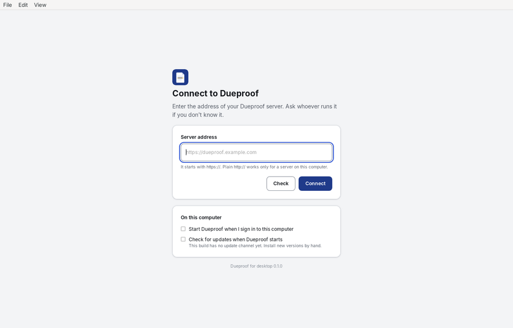
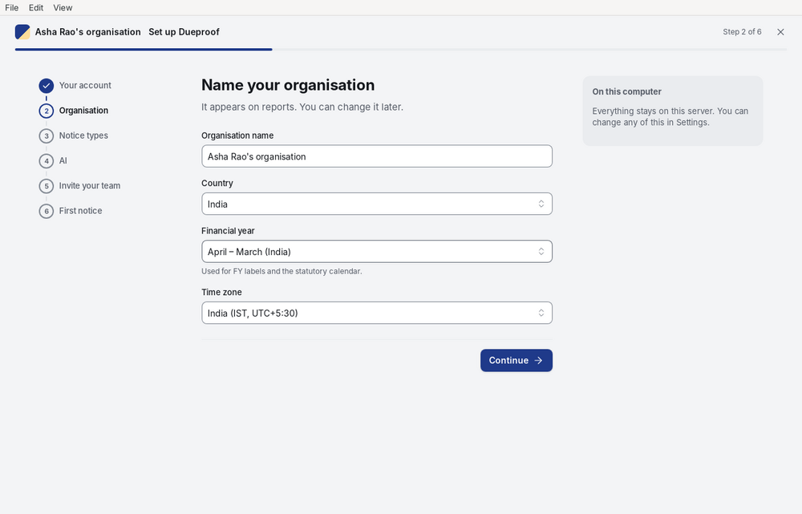

# Desktop app

The Dueproof desktop app is built for Linux in the v0.1 beta. Windows and
macOS builds, signed, come before the beta ends. In v0.1 it **connects to a
Dueproof server**: your own (see [Install](install.md)) or
the hosted service. It shows the same app as the browser, with a few things
a browser tab can't do:

- notifications from the operating system,
- a tray icon (Open, Upload documents, Start at login, Change server, Quit),
- `dueproof://` links that open a page in the app,
- starting when you sign in to the computer, if you want it to.

Running everything on one computer without a server ("Local mode") is not in
v0.1 yet.



## Install

Download the file for your computer from the release page:

| Computer | File |
|---|---|
| Ubuntu, Debian | `Dueproof_0.1.0_amd64.deb` (`sudo apt install ./Dueproof_0.1.0_amd64.deb`) |
| Other Linux | `Dueproof_0.1.0_amd64.AppImage` (make it executable and run it) |

There are no Windows or macOS downloads yet. The v0.1 builds are **not
code-signed yet**.

## Connect to your server

1. Open Dueproof. It asks for your server's address, for example
   `https://dueproof.example.com`. Ask whoever runs your server if you don't
   know it.
2. Choose **Connect**. The app checks that the address is a working Dueproof
   server before it saves it. **Check** only checks.
3. Sign in as you would in a browser.



The address must start with `https://`. Plain `http://` works only for a
server on the same computer (`localhost`), for trying Dueproof out.

To use another server later, choose **Change server…** in the File menu (the
Dueproof menu on a Mac) or in the tray menu.

## What the app can and can't do

The app shows **only your server's pages**. A link to any other website
opens in your normal browser. Your server's pages can ask the app for one
thing: to show a notification. They can't read your files, change the
server address or run programs.

- **Uploading:** drag files or folders onto the upload area, as in a
  browser. Files dropped anywhere else take you to the upload screen. You
  can also choose **Upload documents…** (⌘U on a Mac, Ctrl+U elsewhere).
- **Notifications** use your computer's notification centre. Turn them off
  there if you don't want them.
- **Closing the window** keeps Dueproof running in the tray, so
  notifications still arrive. Choose **Quit** to stop it. On Linux desktops
  without a tray, closing the window quits.
- **Downloads** (reports, evidence packs) go to your Downloads folder.
- **Links:** `dueproof://open?path=/deadlines` opens that page of your
  server in the app. Links to anything other than a page on your server are
  ignored.

## Updates

The app doesn't check for updates unless you ask it to: tick **Check for
updates when Dueproof starts** on the server screen. Every update is signed,
and nothing installs until you say yes. The v0.1 builds have no update
channel yet, so install new versions by hand.

## For administrators

The app keeps its settings in one small file, with no passwords or keys in
it (your sign-in lives in the app's web storage, as in a browser):

| Computer | Settings file |
|---|---|
| Windows | `%APPDATA%\app.dueproof.desktop\settings.json` |
| macOS | `~/Library/Application Support/app.dueproof.desktop/settings.json` |
| Linux | `~/.config/app.dueproof.desktop/settings.json` |

To set the server for people before they first open the app, and to keep
updates off on managed computers, put this file in place:

```json
{
  "serverUrl": "https://dueproof.example.com",
  "updatesEnabled": false,
  "updatesLocked": true
}
```

Building the app yourself, signing and the update key are covered in
[`apps/desktop/README.md`](../apps/desktop/README.md).
