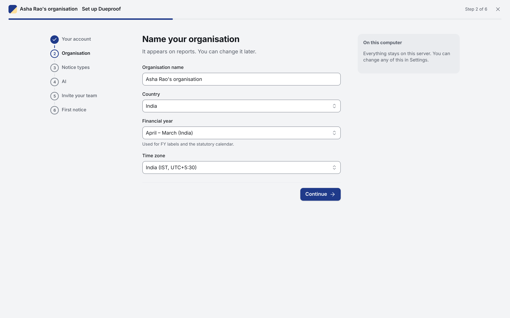
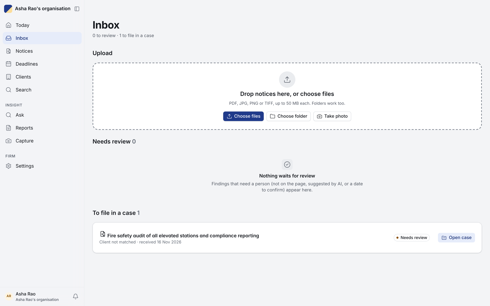
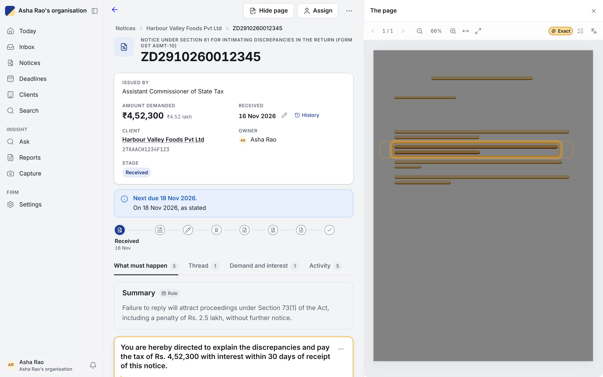
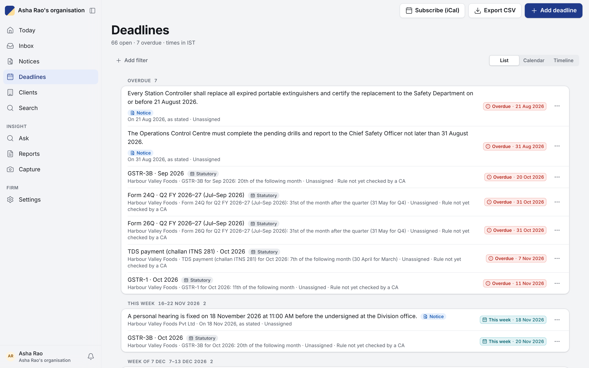
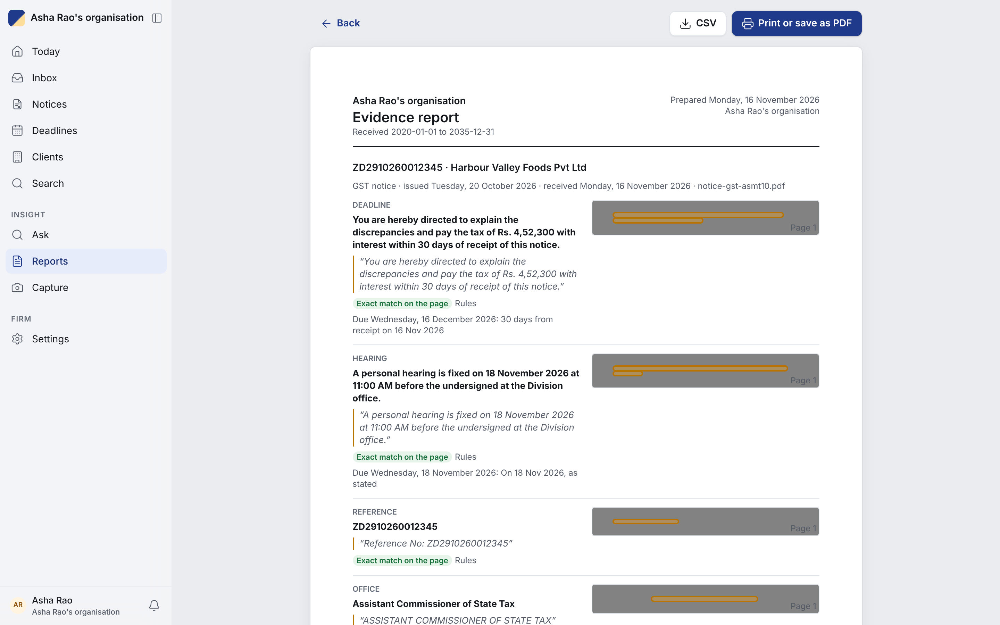

# Quickstart

Your first hour with Dueproof v0.1: from a new account to a deadline you can
prove. It assumes Dueproof is running, on your own server (see
[Install](install.md)) or hosted (see [Deployment](deployment.md)).

## 1. Create the first account

Open Dueproof in a browser and choose **Set up Dueproof**, or go to
`/sign-up`.

- **Self-hosted and desktop:** the first person to sign up creates the
  organisation and becomes its **owner**. After that, sign-up is by
  invitation only.
- **Hosted:** anyone can sign up. Each new account gets its own organisation
  unless someone invited that address.

Passwords are at least 10 characters. You can add a passkey and two-step
verification later, in **Settings → Me** (see
[Accounts and sign-in](accounts-and-sso.md)).

## 2. The setup wizard

The first account goes straight to **Set up Dueproof**, six steps:

1. **Your account**: done when you signed up.
2. **Organisation**: its name (it appears on reports), country, financial
   year and time zone. The time zone decides what "today" and "overdue"
   mean.
3. **Notice types**: GST, Income tax, TDS, ROC / MCA, Courts and tribunals.
   See [Notice types](profiles.md).
4. **AI**: off by default. Rules read every notice either way. See
   [Configuration](configuration.md#ai).
5. **Invite your team**: email addresses and a role. You can skip this.
   No email is sent: copy each person's sign-up link from **Settings →
   Team & access → Invitations** and send it yourself.
6. **First notice**: **Go to Inbox** takes you to the upload area.

Close the wizard with **×** to finish later. Everything in it can be changed
in **Settings**. Only owners and admins see it.

## 3. Upload a notice

Go to **Inbox** (or press **G** then **I**). Drop files on **Drop notices
here, or choose files**, or use **Choose files**, **Choose folder** or
**Take photo**. PDF, JPG, PNG and TIFF are accepted, up to 50 MB each by
default.

Each file shows where it is:

| Shows | What is happening |
|---|---|
| Uploading | The file goes straight to storage, then its size, fingerprint and type are checked |
| Reading pages | The text layer is read; pages without one go through OCR |
| Translating | Only for pages in an Indian language, and only where offline translation is set up |
| Finding dates and duties | The rules (and AI, if it is on) look for duties, deadlines, hearings, amounts, the reference and the issuing office |
| Checking proof | Each quote is looked for on its page, and dates are worked out |
| Ready | Everything found is on the page and nothing waits for a person |
| Needs review | At least one finding needs a person before you rely on it |
| This PDF needs a password | Type it in. It is kept encrypted for this read only, then deleted |
| Already in the register | The same file was uploaded before. Nothing new is made |
| Held for safety review | The stored file didn't match what was uploaded. It was removed |
| Failed | The file couldn't be read |

The day you upload a notice is taken as its **received date**. You can
correct it later (see step 5).

On a phone, **Capture** opens the camera. **Settings → Intake** has a QR code
that opens Capture on your phone.

## 4. File it in a case

Read notices wait under **To file in a case**. Choose **Open case**, pick a
client or type a **New client** (with its GSTIN if you have it), and choose
**Open case** again. If a case with the same reference already exists,
**Add to …** files it there instead.

Dueproof doesn't match a notice to a client by itself in v0.1. You choose.

## 5. The case page

The header shows the issuing office, the amount demanded, the **received**
date, the client, the owner and the **stage**. A banner says what needs
attention: findings to review, an overdue item, or the next due date.

The tabs:

- **What must happen**: the summary and each duty, with its due date and how
  that date was worked out ("30 days from receipt on 16 Nov 2026").
- **Thread**: every document in the case, in order: the notice, your reply,
  the acknowledgement, the order. Drop more files on **Drop files for this
  case**.
- **Demand and interest**: the tax, interest and penalty, with interest
  shown as an estimate.
- **Activity**: notes and the case's history. Type **@** to mention someone.

The stage bar runs from **Received** to **Closed**: Documents gathered,
Draft reply, Partner approval, Filed on portal, Order received, Appeal.
Moving to **Filed on portal** needs the acknowledgement or ARN number and an
uploaded acknowledgement. Dueproof never files anything itself.

**Assign** sets the case owner. **More actions** (⋯) has **Print evidence
report**, **Hearing pack**, **Add a deadline by hand**, **Correct the
received date** and **Close the case**.

### The proof

Every duty carries a page link (**Page 1**, …). Click it: the page opens
beside the case with the quote outlined, and a badge says how well it
matched:

| Badge | Meaning |
|---|---|
| Exact | Found word for word on the page |
| Strong | Found with small differences (spacing, OCR) |
| Approximate | Only part was found. Check the page before relying on it |
| Not located | Not found on the page. A person must confirm it |

A finding that is not located never becomes a deadline until someone
confirms it.

### Receipt-based deadlines

"Within 30 days of receipt" counts from the **received** date, never from the
date printed on the notice. If the notice reached you earlier than you
uploaded it, use the pencil next to **Received** (or **More actions →
Correct the received date**). Every open deadline counted from receipt moves
with it, and **History** shows each change.

## 6. Review what Dueproof isn't sure of

A finding waits for a person when:

- its quote wasn't found on the page,
- it was read with low confidence,
- AI suggested it and nobody has checked it yet,
- it has a date that waits for a person to confirm it, or
- the rules and AI read it differently.

These appear under **Needs review** in the Inbox and on the case page.
In the Inbox list:

| Key | Does |
|---|---|
| **J** / **K** | Next / previous |
| **Enter** | Confirm |
| **E** | Edit |
| **X** | Dismiss (with **Undo**) |

Viewers can read the queue but can't confirm.

## 7. Deadlines

**Deadlines** lists every deadline from notices, orders, client
registrations and ones added by hand. Switch between **List**, **Calendar**
and **Timeline**. **Add filter** narrows by client, person, type, status or
source.

Each row's ⋯ menu has **Mark done** (or **Reopen**), **Assign to**,
**Snooze** (until tomorrow, for 3 days or for a week) and **Dismiss**. On a case page, the same is under each duty's
**More actions**: **Mark done** and **Correct due date** (with a reason;
the original date is kept).

**Subscribe (iCal)** makes a private calendar link for **My deadlines** or
**All deadlines**, for Google Calendar, Outlook or Apple Calendar. It holds
titles and dates only. **Export CSV** downloads what is shown.

## 8. Clients

**Clients** lists everyone you act for, with open and overdue items. Add one
with **New client** (name, PAN, TAN, GSTINs, CIN, partner, tags) or bring in
a CSV with **Import**.

On a client's page, **Registrations → Add registration** (GST, TDS, income
tax, ROC) builds that client's **statutory calendar**: GSTR-1 and 3B, TDS
payments and returns, and so on. These appear in Deadlines marked
*Statutory*. Every period comes from data with a source, and each is marked
"Rule not yet checked by a CA" until one signs it off.

## 9. Reminders

- **The morning digest** emails each person what is overdue, due today and
  due this week, and what awaits their approval.
- **Notifications** go to a deadline's owner when it is due within two days
  or overdue, and when someone assigns them a deadline or mentions them.
  Overdue items go to managers after 3 days and to the client's partner
  after 7 (change this in **Settings → Organisation → Escalation**).
- **Web Push**: turn on **Notifications on this device** in **Settings → Me**.
  On an iPhone, add Dueproof to the Home Screen first. A push says only
  "A deadline is coming up" or similar: no client names, amounts or text.
- **The desktop app** shows the same notifications as system alerts while it
  is open (see [Desktop app](desktop.md)).

The digest and the due-soon and overdue notifications come from one daily
run. On a self-hosted server it needs setting up: see
[Workflow and reminders](workflow-and-reminders.md#the-daily-run).

## 10. The evidence report

**Reports → Evidence report** (or **Print evidence report** on a case)
shows each finding beside a crop of the page that proves it, with its quote,
how well it matched, where it came from and how its date was worked out.
Choose a case, a client or a received-date range. **Print or save as PDF**
makes an A4 copy for a meeting or an inspection; **CSV** downloads the same
rows.

Reports also has the **Client statement**, **Workload**, **Exposure** and
**Hearing pack**.

## 11. Find anything

- **⌘K** (Ctrl+K on Windows and Linux) opens the command palette: jump to
  any screen, upload a notice, add a client, invite people, or search.
- **Search** looks through the text of every page and finding, in any
  language, and through case references and client names. A result opens
  the case.
- **G** then a letter jumps to a screen: **T** Today, **I** Inbox,
  **N** Notices, **D** Deadlines, **C** Clients, **S** Settings.

**Today** brings it together: what is overdue, due today, this week and the
week's hearings, what needs review, what was received recently and what
awaits approval. Switch between **Mine**, **My team** and **Everyone**.

## Next

- [Workflow and reminders](workflow-and-reminders.md)
- [Notices](notices.md): what is read from a notice, and how
- [Accounts and sign-in](accounts-and-sso.md)
